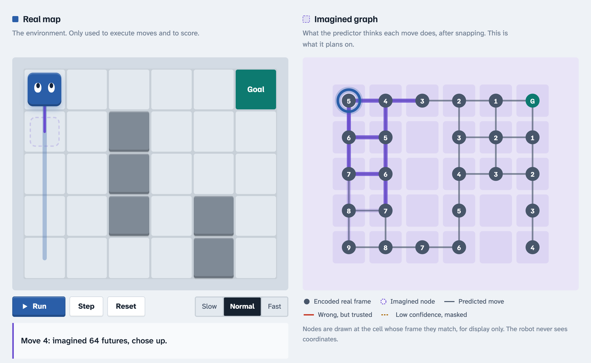
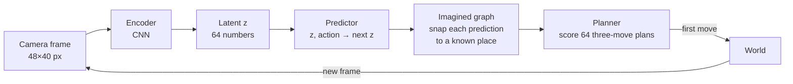
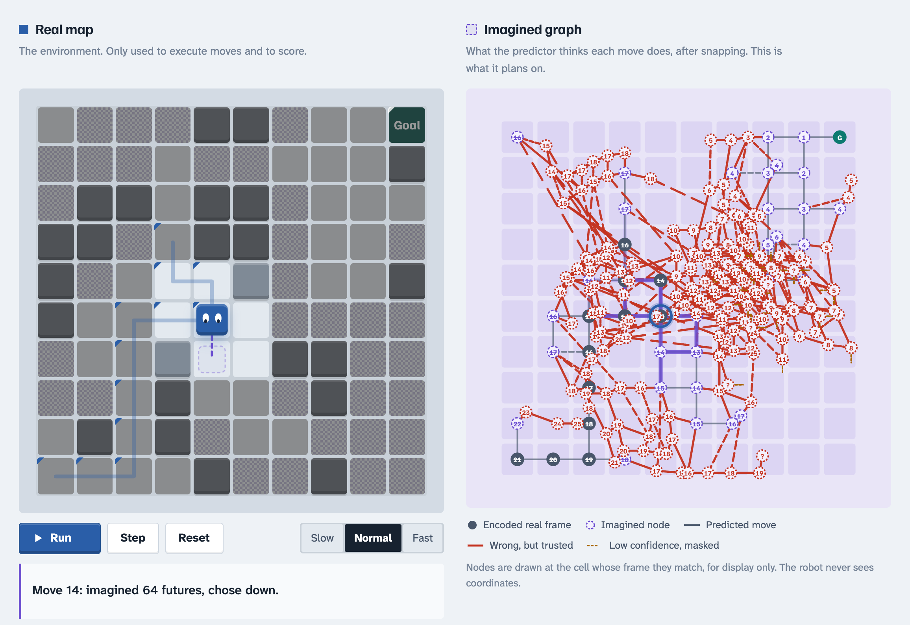

# Mini-JEPA: a robot that plans in its imagination

A small **JEPA world model** (Joint-Embedding Predictive Architecture) that learns, from pixels
alone, how its actions change what it sees, and then plans by imagining moves in its latent
space. It never redraws a picture. Trained on 70 grid mazes, it finds its way through layouts
it has never seen, and with fog of war it explores a map it cannot see.

**[Try the live demo →](https://jepa-robot-navigation.vercel.app)** Draw walls, press Run and
watch it think. It runs entirely in your browser; nothing is sent to a server.



*Left: the real map. Right: what the robot imagines. Each node is a place it predicts it can
reach, labelled with its imagined number of steps to the goal. The purple path is the plan it
chose out of 64 imagined futures.*

## How it works



1. **See.** A CNN encoder turns each frame into a 64-number latent.
2. **Imagine.** A predictor maps (latent, action) to the next latent. It is trained JEPA-style:
   its prediction must match a slowly updated copy of the encoder applied to the real next
   frame, with variance and covariance terms to stop the latents collapsing. There is no
   decoder and no pixel loss.
3. **Plan.** Every imagined step is snapped to the nearest known place, so the predictions form
   a graph. The planner scores all 64 three-move sequences by imagined steps to the goal,
   makes the first move, looks again and replans.

## Results

All numbers are on maps never used for training or for choosing settings. Every setting was
chosen on separate validation maps, and each test set was run once.

| Experiment | What the robot is given | Reaches the goal |
|---|---|---|
| 1,200 new 6 × 5 layouts, mazes included | a picture of itself on every free cell | **100%** (shortest path 100%) |
| Same networks, trained to redraw pixels instead (mazes) | the same | 79% |
| New 6 × 5 mazes | only the start and goal pictures, then what it sees while walking | 83% (94% with a larger move budget) |
| New 10 × 10 maps, **fog of war** (3 × 3 view) | start and goal pictures, then what it sees | **100%** |
| New 10 × 10 mazes, fog of war | the same | **97.8%** |
| New 10 × 10 mazes, fog of war | imagination only, no correction while walking | 14% |



*Fog of war: the robot sees only the 3 × 3 cells around it (lit). On the right, the places it
has really seen (dark) sit among many imagined ones; red marks imagined moves that are wrong.
It replaces them with what it actually experiences as it walks.*

What worked, what didn't, and why, with every number traced to a results file:
**[REPORT.md](REPORT.md)**.

## Quick start

Python 3.10+ and a CPU are enough.

```bash
python -m venv .venv
.venv/bin/python -m pip install -r requirements.txt
.venv/bin/python -m pytest -q                 # 198 tests, about a minute
```

Trained checkpoints, datasets and results are in the repo, so every evaluation below runs
without retraining.

**Run the demo locally** (plain JavaScript, no build step):

```bash
cd web && python -m http.server 8765           # open http://127.0.0.1:8765
```

## Reproducing the experiments

Each experiment has one config in [configs/](configs/); its data, checkpoints and results live in
matching folders (`datasets/<name>/`, `checkpoints/<name>/`, `results/<name>/`).

| Config | Experiment | Report | Main commands | CPU time |
|---|---|---|---|---|
| `single_map` | One fixed map: fit vs generalization | §2 | `python main.py all` | ~10 min |
| `single_map_jepa` | Joint JEPA training on one map | §3 | `python main.py train-jepa --config configs/single_map_jepa.yaml`, then `eval` | ~1 min |
| `multimap` | 100 maps, autoencoder baseline | §4 | `python main.py multimap --config configs/multimap.yaml` | not recorded |
| `multimap_jepa` | 100 maps, joint JEPA; stress tests, graph planning | §4–5 | `python main.py multimap-jepa --config configs/multimap_jepa.yaml`, then `python -m multimap.new_maps --set maze_maps --threshold calibrated --planner snap --config configs/multimap_jepa.yaml` | ~13 min + eval |
| *(baselines)* | Pixel world model and ablations, several seeds | §6 | `python -m multimap.step3 train`, `eval`, `summary` | ~1 h per pixel seed |
| `multimap_jepa` | Without the every-cell pictures: imagine / explore | §7 | `python -m multimap.explore --set maze_maps` | ~6 min |
| `fog` | Fog of war on a 10 × 10 grid | §8 | see below | ~1.5 h training |

Fog of war, in order (validation first; the test sets exclude the validation maps):

```bash
python -m multimap.collect     --config configs/fog.yaml
python -m multimap.train_jepa  --config configs/fog.yaml
python -m multimap.calibrate   --config configs/fog.yaml
python -m multimap.explore --config configs/fog.yaml --set val_fog_maps --modes privileged,imagine,explore,oracle --budget explorer --workers 7
python -m multimap.explore --config configs/fog.yaml --set fog_maps     --modes privileged,imagine,explore,oracle --budget explorer --workers 7
```

`--workers N` splits the maps over processes; the counts are identical to one process. Use
`.venv/bin/python` (or an activated environment) for every command.

**Web demo.** `python web/export_models.py` re-exports the weights and test vectors from the
checkpoints. `node web/test/check.mjs` checks the JavaScript port against PyTorch: frames,
latents, imagined graphs and plans must match on 10 layouts. `node web/test/explore_bench.mjs
fog_maps 20` compares the browser planner's navigation with the Python results.

**Look inside.** `python -m environment.viewer` lets you play the grid yourself.
`python -m visualization.dashboard --run P2 --start 0,4` replays any single-map evaluation
episode step by step.

## Repository layout

```
configs/         one YAML per experiment (each extends single_map.yaml)
environment/     grid world, renderer (with fog of war), BFS oracle, pygame viewer
data/            data collection, episode split, held-out pairs, datasets (code)
models/          encoder, decoder, residual predictor, coordinate baseline
training/        single-map training: autoencoder, predictor, joint JEPA
planning/        imagination, imagined graph and steps-to-goal, planners, MPC loop
evaluation/      probes, prediction accuracy, navigation, diagnostic ladder, plots
multimap/        many-map experiments: maps, training, stress tests, calibration, baselines, explore
visualization/   episode replay dashboard
web/             browser demo: JavaScript port of the renderer, networks and planner
tests/           pytest suite
datasets/  checkpoints/  results/    generated data, trained models and result tables, one folder per experiment
docs/            images for this README
```

## Rules the code keeps

- **Models never read the simulator's rules.** True positions are used only for probes,
  splitting and scoring. Imagination code does not import the simulator, and a test runs it
  with every simulator entry point disabled.
- **No test data leaks into choices.** Encoders, normalisation statistics and probes are fit on
  training data only. Checkpoints and thresholds are chosen on validation maps, and test maps
  are used once.
- **Fit and generalization are reported separately**, so that memorising the training maps
  can't pass as learning.

Comments in the code that cite "spec" or "build plan step N" refer to the original design
documents, which are not part of this repository.
